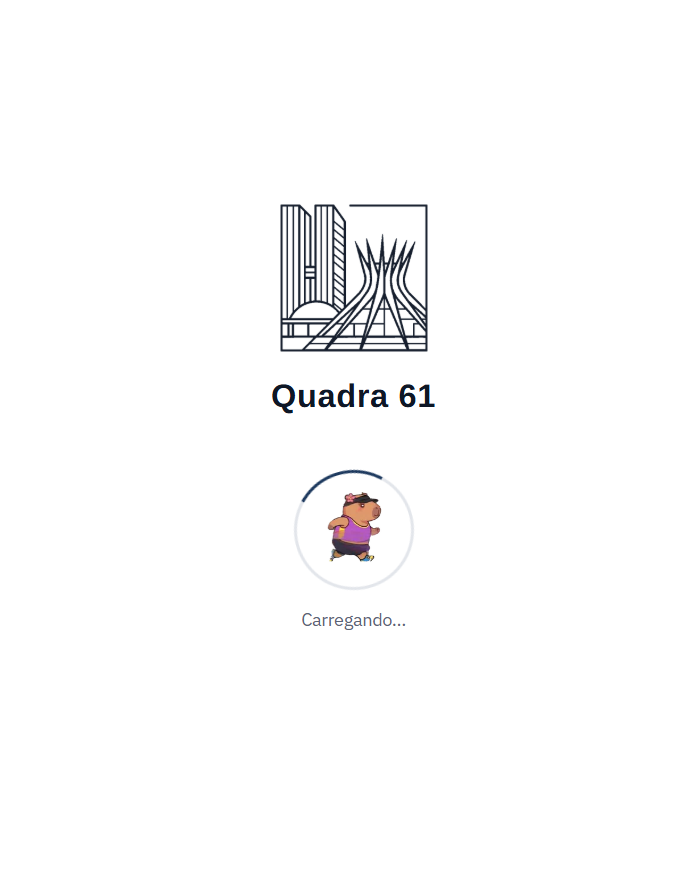
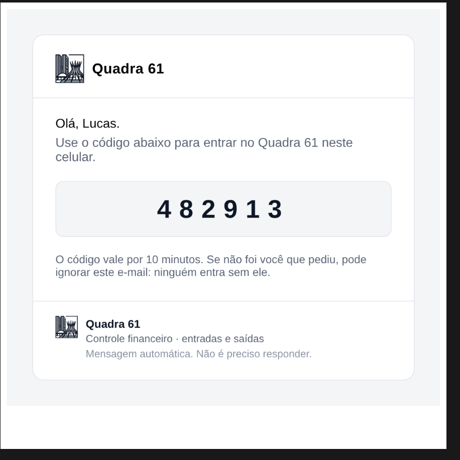
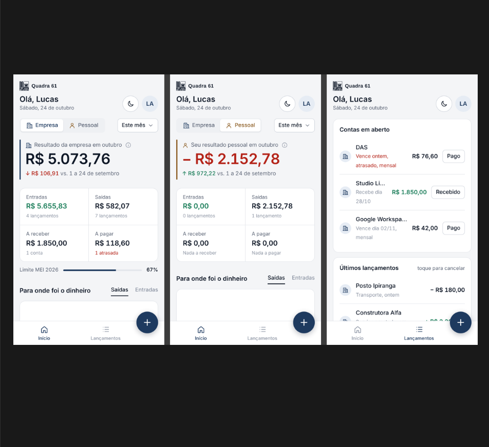
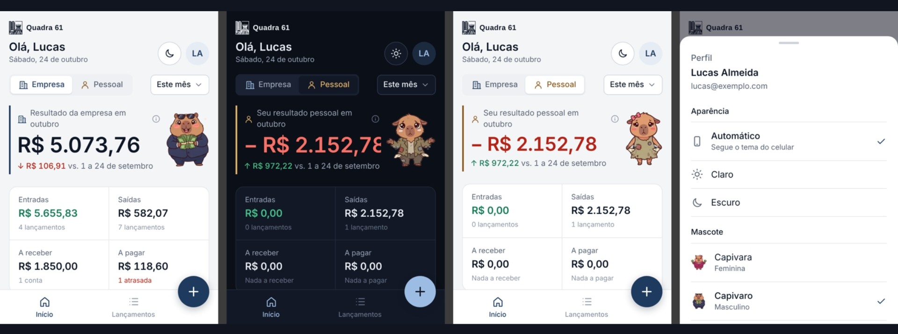
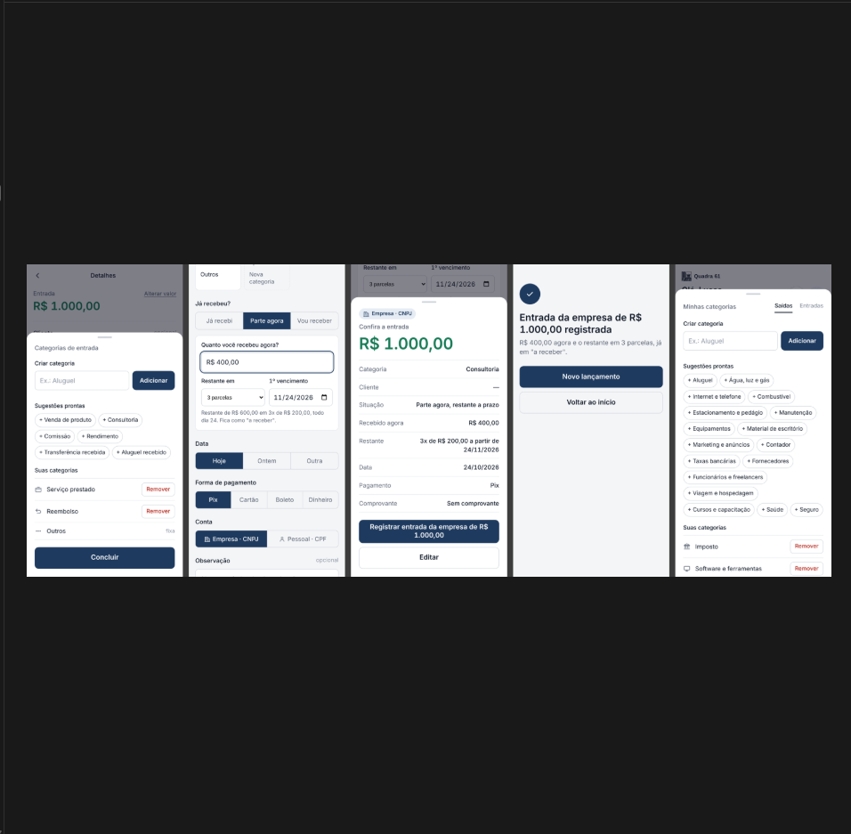
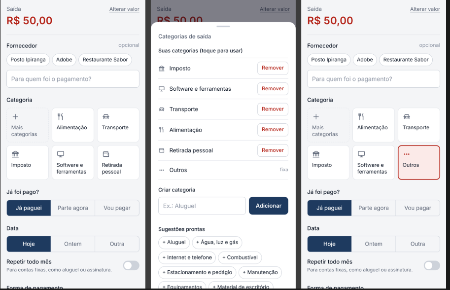
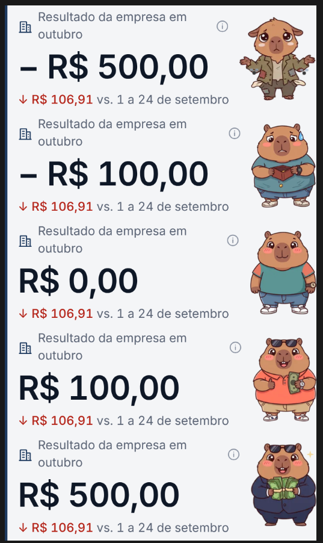
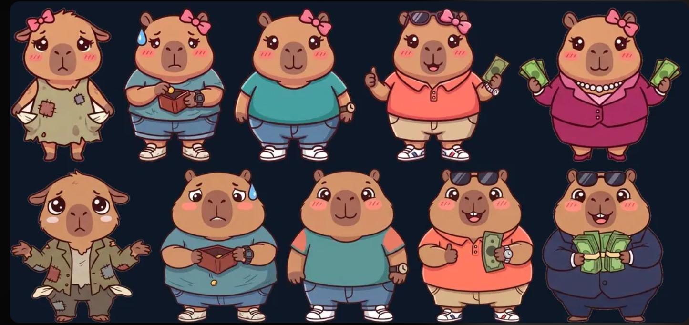

# 🦫 Quadra 61 — Controle Financeiro Pessoal & Empresarial (CPF/CNPJ)

<p align="center">
  
  
  
  
  
</p>

> ⚠️ **Nota de Privacidade & Segurança:** Este repositório é um **Estudo de Caso e Documentação de Arquitetura** do aplicativo **Quadra 61**. O código-fonte completo é mantido em repositório privado para proteção dos dados dos usuários ativos e integridade das rotas da API.

---

## 📌 Visão Geral

O **Quadra 61** é uma aplicação web progressiva (PWA) de controle financeiro desenvolvida para resolver um dos maiores problemas de pequenos empreendedores e autônomos: a **mistura de caixa entre a Pessoa Física (CPF) e a Pessoa Jurídica (CNPJ)**.

Focado na usabilidade mobile de ritmo rápido, o aplicativo permite lançamentos em poucos toques com uma arquitetura **100% Serverless e de custo zero de infraestrutura**, alimentando uma base de dados estruturada pronta para **Business Intelligence (BI)** em tempo real.

### 🎯 Destaques do Projeto
- 🔒 **Isolamento de Contas:** Separação visual e lógica completa entre CPF e CNPJ.
- ⚡ **Alta Velocidade:** Fluxo de lançamento otimizado para celulares sem telas desnecessárias.
- 💰 **Custo Zero:** Infraestrutura rodando totalmente em soluções gratuitas e escaláveis.
- 📈 **Pronto para Analytics:** Dados armazenados de forma relacional para consumo direto em dashboards (Power BI / Looker Studio).

---

## 📸 Demonstração Visual

<p align="center">
  
  
</p>

<p align="center">
  
  
</p>

<p align="center">
  
  
</p>

<p align="center">
  
  
</p>

---

## ✨ Funcionalidades Principais

### 🔑 Acesso Rápido & Sem Senha (Passwordless)
- **Autenticação OTP:** O usuário insere o e-mail e recebe um código temporário formatado com a identidade visual do **Quadra 61**.
- **Sessão Persistente:** Após o primeiro acesso com o nome, os acessos seguintes são diretos.
- **Isolamento Multi-tenant:** Cada usuário possui o seu próprio identificador e acessa apenas os seus lançamentos.
### ⚡ Lançamento Inteligente em Poucos Toques
- **Alternância de Contexto:** Escolha rápida entre **Empresa (CNPJ - ícone de prédio)** e **Pessoal (CPF - ícone de pessoa)**, com esquemas de cores distintos para evitar confusões.
- **Categorização Dinâmica:** Botão de acesso rápido com as 5 categorias mais utilizadas visíveis de imediato (priorizando as criadas pelo usuário).
- **Divisão Automática de Pagamentos:**
  - Opções: *Já paguei*, *Vou pagar* ou *Parte agora*.
  - Ao escolher pagamento parcial, o app calcula a entrada e gera automaticamente o parcelamento do valor restante.

### 🦫 Mascote Gamificado (Capivara)
- **Feedback Financeiro Emocional:** A capivara muda de expressão e animação de acordo com o resultado do período em 5 estados: *Pobre, Apertada, Neutra, Tranquila e Rica*.
- **Personalização:** Possibilidade de escolher entre versão feminina, masculina ou ocultar o mascote.

### 📱 Experiência Mobile & Interface
- **Instalação PWA:** Adicione à tela inicial do celular para funcionar como um aplicativo nativo.
- **Modos de Visualização:** Suporte completo a Modo Claro (*Light Mode*) e Modo Escuro (*Dark Mode*).

---

## 🏗️ Arquitetura & Engenharia de Dados

O **Quadra 61** foi projetado para ter **custo zero de infraestrutura**, alta performance em conexões móveis e facilidade de integração com ferramentas de análise.

```text
[ Cliente (PWA / Mobile) ]
           │
           ▼  (HTTPS / Host Vercel)
[ Frontend Web ] ───(Chave Assinada + OTP)───► [ Google Apps Script (Backend API) ]
                                                            │
                                                            ▼
                                                [ Google Sheets (Database) ]
                                                            │
                                                            ▼
                                              [ Camada BI (Power BI / Looker) ]
```
### 🧱 Pilares da Infraestrutura
- **Frontend & PWA:** Hospedado na **Vercel**, garantindo entrega rápida e suporte a instalação na tela principal do celular.
- **Backend Serverless:** Desenvolvido em **Google Apps Script**, atuando como uma API REST leve para processar requisições.
- **Base de Dados Relacional:** **Google Sheets** estruturado em abas dedicadas (`Lançamentos`, `Recorrentes`, `Usuários`, `Categorias`), pronto para ser consumido por conectores de BI.

---

## 🔒 Segurança & Proteção de Dados

- **Isolamento de Dados (Multi-tenant):** Cada usuário possui um `UID` único associado ao e-mail. O backend valida a identidade em todas as chamadas, impedindo o acesso cruzado a dados de terceiros.
- **Autenticação Segura:** Envio de códigos temporários (OTP) com limite configurado de tentativas para prevenir abusos (*rate limiting*).
- **Proteção das Rotas:** Comunicação entre o PWA e o Apps Script protegida por chaves de assinatura nas requisições.

---

## 🛣️ Roadmap & Próximos Passos

- [x] Autenticação *passwordless* via e-mail (OTP)
- [x] Separação nativa de contextos CPF e CNPJ
- [x] Cálculo e geração automática de parcelas
- [ ] **Otimização de Ícones Android:** Ajuste de resoluções no *manifest* para maior nitidez na tela inicial do Android.
- [ ] **Animações do Mascote:** Integração de vídeos/Lottie para os 5 estados da capivara.

---

## 👤 Autor

**Arão Côrtes**  
Estudante de Administração & Inteligência Artificial / Machine Learning  

- **LinkedIn:** [linkedin.com/in/arao-cortes](https://www.linkedin.com/in/arao-cortes)
- **GitHub:** [@zxcortes](https://github.com/zxcortes)
- **E-mail:** [araoalmeida511@gmail.com](mailto:araoalmeida511@gmail.com)
